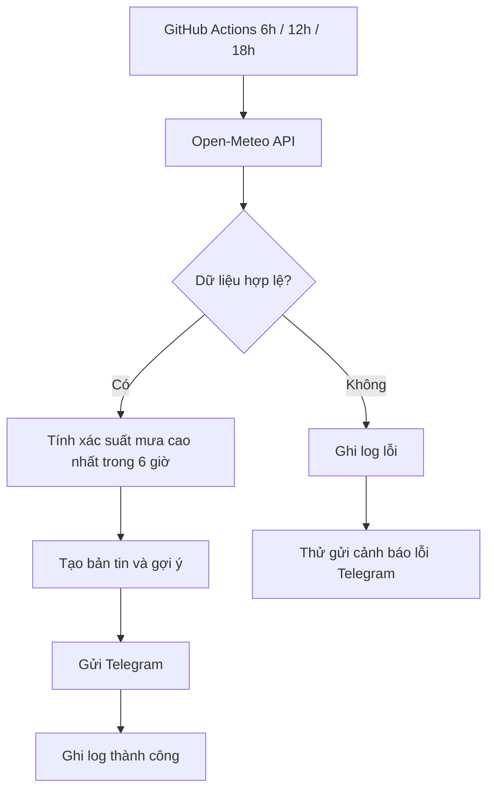

# Task 14 — Bot Telegram dự báo thời tiết 3 lần/ngày

## Mục tiêu
Bot tự chạy trên GitHub Actions lúc **06:00, 12:00, 18:00 giờ Việt Nam**, kể cả khi máy tính đã tắt. Mỗi lượt gửi một bản tin về 6 giờ tiếp theo, gồm mức nhiệt, xác suất mưa cao nhất, gợi ý mang áo mưa nếu ≥ 50%.

## Chuẩn bị
- GitHub account, Telegram account, Python 3.12 (chỉ cần nếu muốn chạy local).
- Mở Telegram, chat với **@BotFather**, dùng `/newbot` và làm theo chỉ dẫn để tạo bot. Giữ token bí mật.
- Mở chat với bot mới và nhấn **Start**.
- Lấy chat ID của chính bạn: mở URL `https://api.telegram.org/bot<TOKEN>/getUpdates` trong trình duyệt **riêng** sau khi gửi cho bot một tin nhắn, tìm `message.chat.id`. Không chia sẻ URL có token hoặc ảnh màn hình chứa token.

## Cài chạy tự động GitHub (không cần bật PC)
1. Tạo một repository GitHub **private** và tải nguyên cấu trúc project lên (bao gồm thư mục `.github/workflows`).
2. Vào **Settings → Secrets and variables → Actions → New repository secret**, tạo hai secrets: `TELEGRAM_BOT_TOKEN`, `TELEGRAM_CHAT_ID`. Không tải file `.env` lên GitHub.
3. Vào tab **Actions**, chọn **Telegram weather briefing**, nhấn **Run workflow** để chạy thật một lần. Xem tin nhắn Telegram và log.
4. File `.github/workflows/weather.yml` đã đặt lịch `0 6,12,18 * * *` với timezone `Asia/Ho_Chi_Minh`. GitHub Actions schedule có thể trễ vào giờ đông tải, không cam kết đúng từng phút. Workflow chạy từ default branch; nếu Actions bị tắt hoặc repo không còn hoạt động, lịch có thể dừng.
5. Muốn đổi khu vực thì sửa `CITY_NAME`, `LATITUDE`, `LONGITUDE` trong workflow; đẩy commit mới. Muốn đổi ngưỡng mưa sửa `RAIN_THRESHOLD`.

## Kiểm thử không gửi tin thật (an toàn)
Trong thư mục project chạy:

```bash
python -m unittest discover -s tests -v
python weather_bot.py --mock rain --dry-run
python weather_bot.py --mock clear --dry-run
python weather_bot.py --mock error --dry-run
```

- `rain`: tạo bản tin mưa, trả về mã 0, ghi log `DRY_RUN_SUCCESS`.
- `clear`: tạo bản tin không mưa, trả về mã 0.
- `error`: mô phỏng API hỏng, trả về mã 1, ghi `FAILED` và **không** gửi Telegram.
- Khi chạy thật, nếu Open-Meteo lỗi mà Telegram còn dùng được, bot sẽ cố gửi thông báo lỗi.

## Chạy thật trên máy (tùy chọn)
Sao chép `.env.example` thành `.env` rồi điền token và chat ID. Chạy `python weather_bot.py`. Không chia sẻ `.env`.

## Quy trình thủ công (để đưa vào báo cáo)
Người dùng mở ứng dụng dự báo thời tiết, xem xác suất mưa, ghi nhớ thời gian và chuẩn bị đồ mang theo. Lặp lại 3 lần/ngày. Automation thay bằng truy vấn Open-Meteo, phân tích, gửi Telegram và ghi log tự động.

## Đầu vào / đầu ra / trigger / xử lý lỗi
- Đầu vào: tọa độ, ngưỡng mưa, dữ liệu hourly Open-Meteo, secrets Telegram.
- Đầu ra: tin nhắn cá nhân trên Telegram, log phiên chạy (artifact tồn tại 7 ngày).
- Trigger: cron 06:00/12:00/18:00 Asia/Ho_Chi_Minh hoặc Run workflow thủ công.
- Lỗi: thiếu dữ liệu, lỗi mạng/HTTP, sai token, thiếu secrets → workflow thất bại và ghi log; cố thông báo qua Telegram khi phù hợp.
- An toàn: không xóa hoặc gửi dữ liệu cá nhân; token nằm trong GitHub Secrets.

## Sơ đồ


## Ảnh minh chứng cần tự chụp để nộp
1. Workflow trên GitHub Actions có 3 giờ chạy.
2. Kết quả unit tests (`python -m unittest discover -s tests -v`).
3. `--mock rain --dry-run`: bản tin cảnh báo mưa.
4. `--mock error --dry-run`: thông báo FAILED và logs/weather.log.
5. Tin nhắn nhận được trong Telegram khi nhấn Run workflow (che tên/chat ID/token nhạy cảm).

> Lưu ý: Xác suất mưa là dự báo, không đảm bảo trời sẽ mưa. Open-Meteo dùng cho cá nhân/phi thương mại theo điều khoản của họ.
